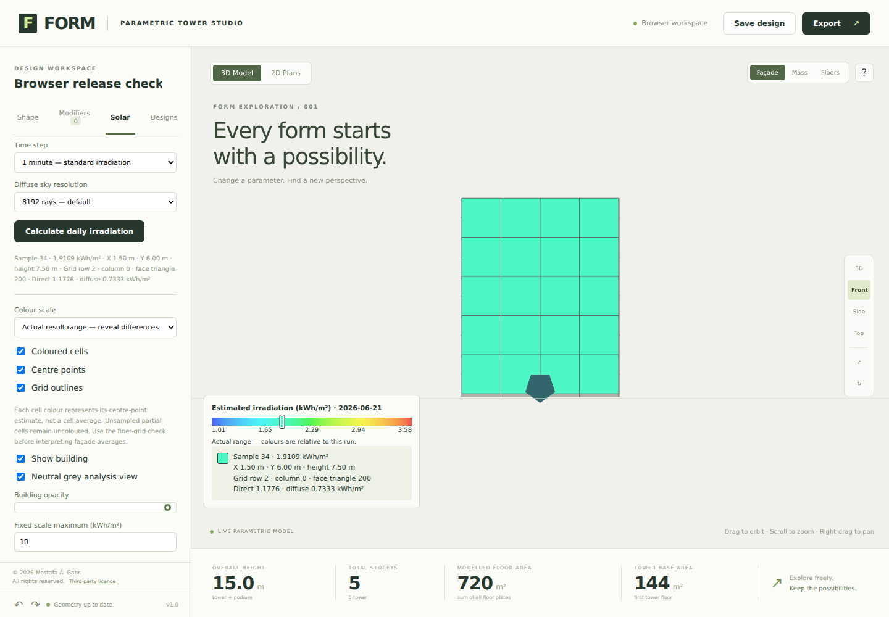
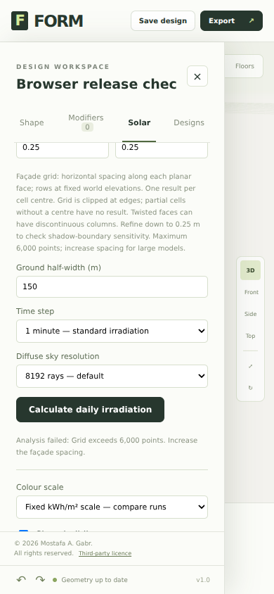

# Irradiation release review — 17 October 2026

## Decision

The tested integration meets the defined numerical and browser release gates for a conceptual irradiation tool. It is ready to update PR #1 and merge after GitHub confirms the expected head/base, mergeability and repository checks. This report is an engineering assessment, not external peer review or field validation.

## Changes

- Preserve the audit corrections, main’s pvlib benchmark, environmental comparisons, configurable façade grid and clipped heatmaps.
- Cap production irradiation geometry at one minute; expose 15/30-second refinement. Hourly weather remains constant within each input interval.
- Use 8192 irradiation sky directions by default and a spherical Fibonacci distribution with cosine normalization. Keep explicitly saved 512/2048/8192 selections. Daylight/VSC keeps its existing separate sampling method.
- Permit façade grids down to 0.25 m; retain the 6,000-point/resource limits and visible errors rather than silently dropping samples.
- Version CSV replay as FORM-irradiation-4 and history as FORM-environment-2026-10-17-convergence. Reject cross-engine deltas; preserve the original effective step when comparing legacy runs.

## Evidence

| Release check | Result |
|---|---|
| Matched one-minute daily totals | 140/140 pass |
| Daily MAE / maximum absolute difference | 0.000296 / 0.001699 kWh/m² |
| Default sky factors | 35/35 pass; maximum difference 0.001042 |
| One-minute vs 15-second reference | 140/140 pass; maximum change 0.004359 kWh/m² |
| 30-second vs 15-second reference | 140/140 pass; maximum change 0.002614 kWh/m² |
| 0.5 m vs 0.25 m probe-plane means | 5/5 pass |
| JavaScript regressions | 115/115 pass |
| Independent pvlib benchmarks | Both commands pass; 144 main cases and audit suite retained |
| Field-data parser tests | 6/6 pass; synthetic parser inputs are not measurements |
| Browser assertions | 20/20 pass in Chromium 153.0.8010.0 |

Daily limits remain max(0.02 kWh/m²,2% reference); sky limit remains 0.005. Time and spatial diagnostics use max(0.01 kWh/m²,1% finer result). These are project criteria, not an international standard or field-accuracy specification. Detailed outcomes are in results.json.

| Scene | 1 m mean | 0.5 m mean | 0.25 m mean | 0.5→0.25 m change |
|---|---:|---:|---:|---:|
| box | 1.006423 | 1.006423 | 1.006423 | +0.000000 |
| overhang | 0.525286 | 0.524613 | 0.524388 | -0.000225 |
| setback | 1.006423 | 1.006423 | 1.006423 | -0.000000 |
| courtyard | 0.531675 | 0.531278 | 0.531142 | -0.000136 |
| neighbours | 0.486910 | 0.487060 | 0.487178 | +0.000118 |

Units: kWh/m², Cairo synthetic summer day. These are unweighted point means on explicitly defined probe planes, not area-integrated building energy. A finer grid passing these selected cases does not guarantee arbitrary façades are converged. Partial edge cells without a centre remain uncoloured.

## Failed attempt retained and corrected

Simply increasing the regular sky lattice to 8192 directions left three of 35 sky factors outside the unchanged limit. Native Radiance refinement confirmed the discrepancies. `regular-grid-attempt.json` and `sky-refinement.json` preserve the evidence. Replacing the aligned lattice with spherical Fibonacci directions resolved these cases; no thresholds were relaxed. The near-obstruction unit test’s finite plate was extended to cover the new near-horizon rays, keeping its exact-zero assertion focused on ray-offset behavior rather than finite-edge leakage.

The sampling choice is supported by González (2010), *Measurement of Areas on a Sphere Using Fibonacci and Latitude–Longitude Lattices*, Mathematical Geosciences 42, 49–64, https://doi.org/10.1007/s11004-009-9257-x. Its published error-reduction percentages are not transferred to FORM; the values above come from this repository’s independent numerical comparisons.

## Browser scope

The actual application ran with a software WebGL2 renderer at desktop and 390 × 844 mobile viewport sizes. All four modes completed; downloaded CSVs replayed to floating-point roundoff. Checks covered rendered cell selection, direct/diffuse readout, colour/cell/point/grid controls, identical weather reuse during grid refinement, saved comparison incompatibility, cancellation, dense-grid errors and plan/3D view switching. No page or console errors were recorded. Screenshots were inspected.

The browser test intercepts Open-Meteo requests with explicitly synthetic weather to exercise the response/UI contract. Live weather availability, real mobile GPU behavior and Safari were not tested. The packaged Chromium initially required correct system font configuration; that was an environment issue, not a suppressed application failure.

## Remaining scientific limits

No field measurements were supplied. The measurement protocol and analysis tools are prepared, but empirical accuracy and external scientific review remain outstanding. Production physics still omits anisotropic skies, ground/building reflections, glazing transmission and PV conversion. The earlier Radiance factorial experiment characterized those omissions; it did not add them to FORM. Solar vectors are shared in scene transport comparisons; separate pvlib/SPA checks verify solar geometry. Only 15-second temporal and 0.25 m spatial references were examined, so finer convergence is not proven. Stronger defaults cost more calculation time.

These are documented scope limits for conceptual use, not evidence supporting design certification, annual yield or a PhD accuracy claim. See the measurement protocol before making real-world validation claims.

## Reproduction

See README.md for exact commands and runtime requirements; PROTOCOL.md contains prospective criteria and the documented follow-up amendment. Historical audits are retained. `evidence-manifest.json` records hashes of the production modules, scripts, fixtures and numerical/browser outputs used for review.
